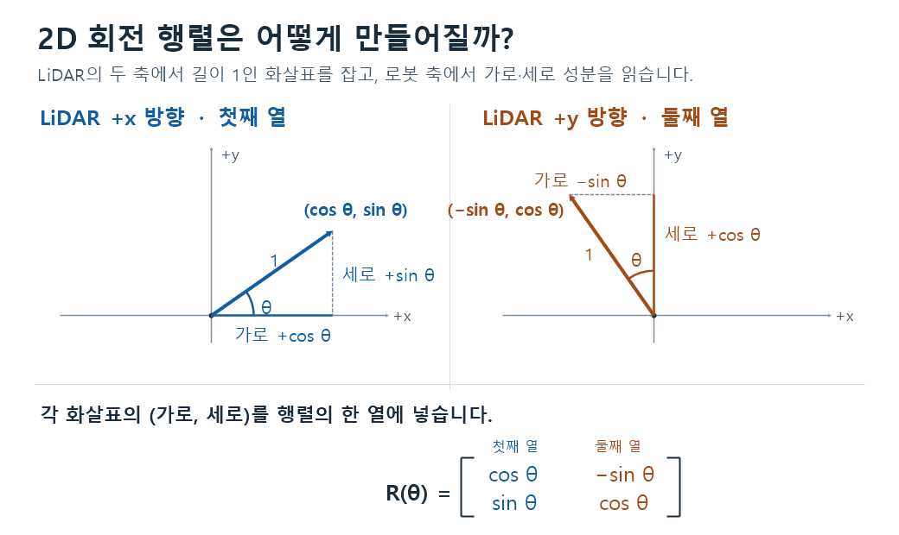
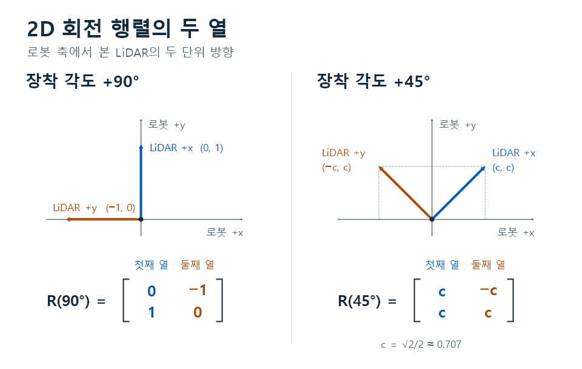
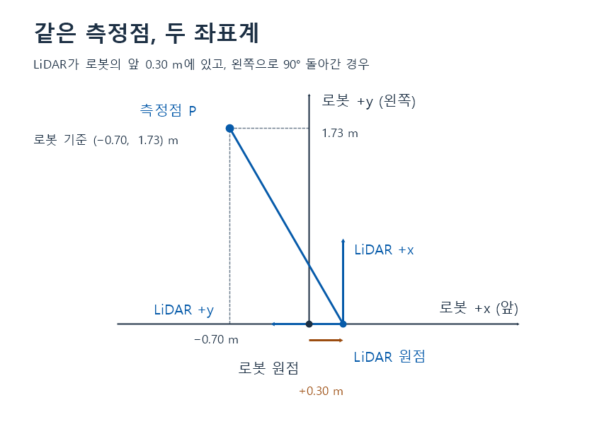

# 1. LiDAR와 로봇의 좌표계

위에서 내려다본 2차원 평면을 가정합니다. 로봇의 $+x$는 전방, $+y$는 왼쪽입니다. 로봇의 $+x$에서 LiDAR의 $+x$까지 반시계 방향으로 잰 장착 각도를 $\theta$라고 둡니다.

## 회전 행렬의 두 열

LiDAR의 $+x$ 방향으로 단위 길이만큼 가면 로봇 축 성분은 $(\cos\theta,\sin\theta)$입니다. LiDAR의 $+y$는 그보다 $90^\circ$ 더 돌아가 있어 $(-\sin\theta,\cos\theta)$입니다. 각 쌍을 열 하나에 넣으면 아래 행렬이 됩니다.

$$
R(\theta)=
\begin{bmatrix}
\cos\theta & -\sin\theta\\
\sin\theta & \cos\theta
\end{bmatrix}
$$

| 장착 각도 | LiDAR의 첫째 축 | LiDAR의 둘째 축 |
|---:|---|---|
| $90^\circ$ | $(0,1)$ | $(-1,0)$ |
| $45^\circ$ | $(1/\sqrt{2},1/\sqrt{2})$ | $(-1/\sqrt{2},1/\sqrt{2})$ |

## LiDAR 원점에서 로봇 원점으로

$p_L$을 LiDAR에서 본 점, $p_B$를 로봇에서 본 점, $t$를 로봇에서 본 LiDAR 원점이라고 합니다.

$$
p_B=R(\theta)p_L+t
\qquad
p_L=R(-\theta)(p_B-t)
$$

정방향에서는 점까지의 이동량을 로봇 축으로 읽고, 로봇 원점에서 LiDAR 원점까지의 이동량을 더합니다. 역방향에서는 $p_B$와 $t$를 로봇 축에서 먼저 빼고, 그 차이를 LiDAR 축으로 읽습니다.

LiDAR가 자기 정면에서 왼쪽 $30^\circ$ 방향으로 2 m를 읽으면 $p_L=(\sqrt{3},1)$ m입니다. 장착 각도 $90^\circ$를 적용하면 $(-1,\sqrt{3})$ m가 됩니다. LiDAR가 로봇보다 30 cm 앞에 있다면 $t=(0.30,0)$ m이므로 $p_B\approx(-0.70,1.73)$ m입니다. LiDAR가 오른쪽으로도 20 cm 떨어져 있다면 $t_y=-0.20$ m가 되어 $p_B\approx(-0.70,1.53)$ m입니다.

[다음 장 · 타임스탬프와 스캔 왜곡 보정](02-time-sync-and-deskew.md)
