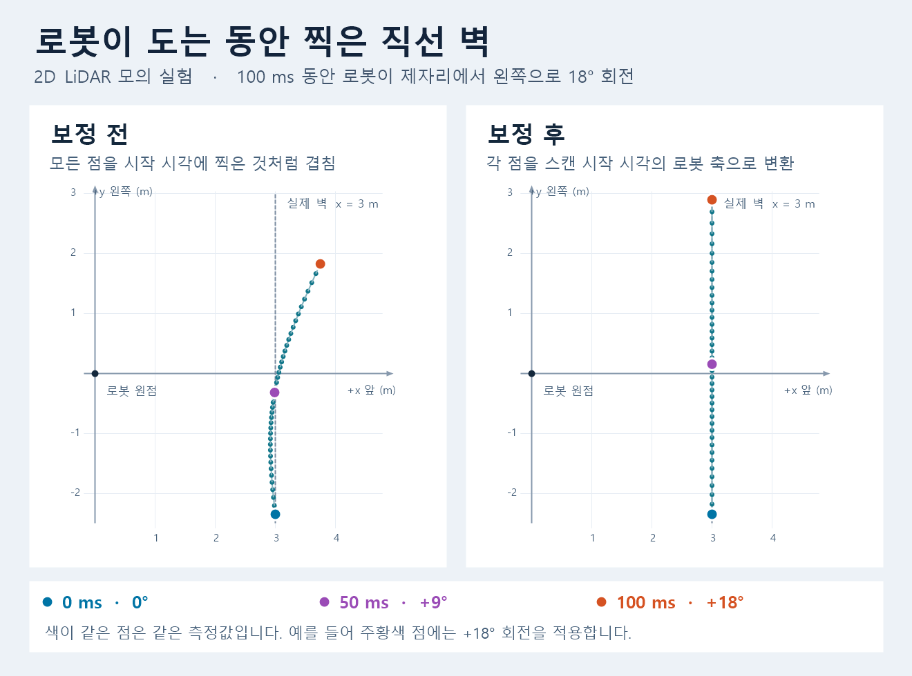

# 2. 타임스탬프와 스캔 왜곡 보정

LiDAR와 IMU 데이터를 함께 쓰려면 각 센서가 **실제로 측정한 시각**을 공통 시계로 표현할 수 있어야 합니다. 컴퓨터가 메시지를 받은 시각에는 전송과 처리 지연이 포함됩니다.

## 측정 시각에 해당하는 IMU 값을 찾기

| 센서 | 공통 시계에서 측정한 시각 | 컴퓨터 도착 시각 | 값 |
|---|---:|---:|---|
| IMU 자이로 | 100 ms | 103 ms | $10^\circ/\mathrm{s}$ |
| LiDAR | 105 ms | 120 ms | 거리와 방향 |
| IMU 자이로 | 110 ms | 113 ms | $14^\circ/\mathrm{s}$ |

두 IMU 샘플 사이에서 각속도가 직선처럼 변했다고 가정하면, 105 ms의 각속도는 $10+(5/10)(14-10)=12^\circ/\mathrm{s}$입니다. 각도 변화량은 시간이 지나며 각속도를 누적해 구합니다. 이 예제의 100~105 ms 구간에서는 평균 속도 $11^\circ/\mathrm{s}$에 0.005 s를 곱한 $0.055^\circ$입니다.

| 가진 데이터 | 필요한 시각의 자세를 구하는 한 가지 방법 |
|---|---|
| IMU 자이로의 각속도 | 짧은 구간의 각속도를 선형 보간하고 시간에 따라 적분 |
| 이미 계산된 2D 위치와 수평각 | 가까운 두 위치를 선형 보간하고, 회전 방향을 유지하도록 각도 경계를 처리한 뒤 수평각을 보간 |
| 두 시각의 3D 방향을 나타낸 쿼터니언 | 구면 선형 보간(SLERP)으로 두 방향 사이를 계산 |

보간의 정확도는 샘플 간격과 실제 움직임에 좌우됩니다. $179^\circ$에서 $-179^\circ$까지 연속해서 조금만 돌았다면, 중간값은 $180^\circ$ 부근입니다. LIO-SAM은 자이로로 계산한 누적 회전 성분을 각 점의 시각에 맞춰 선형 보간합니다. [LIO-SAM 구현](https://github.com/TixiaoShan/LIO-SAM/blob/master/src/imageProjection.cpp)

## 한 스캔 안의 점을 같은 시각으로 옮기기

그림은 로봇이 제자리에서 100 ms 동안 왼쪽으로 $18^\circ$ 돈 모의 실험입니다. LiDAR와 로봇의 원점 및 축이 일치한다고 가정했습니다. 50 ms에 찍힌 점에 $R(+9^\circ)$, 100 ms에 찍힌 점에 $R(+18^\circ)$를 적용하면 둘 다 시작 시각의 로봇 축에서 표현됩니다.

ROS 2의 `LaserScan` 정의에서 `header.stamp`는 첫 광선의 측정 시각, `time_increment`는 연속 광선 사이의 시간입니다. 드라이버가 이 정의에 맞는 값을 제공한다면, 0부터 세는 광선 번호 $i$의 시각은 $t_i=t_0+i\Delta t$로 구합니다. [ROS 2 Jazzy 메시지 정의](https://raw.githubusercontent.com/ros2/common_interfaces/jazzy/sensor_msgs/msg/LaserScan.msg)

로봇이 전진도 했다면 시각 사이의 원점 이동량도 더합니다. 기준 시각 로봇 축으로 표현한 원점 이동량을 $d_i$, 기준 시각에서 점의 측정 시각까지의 수평 회전각을 $\Delta\theta_i$라고 쓰면 다음과 같습니다. $p_i$는 측정 시각의 로봇 좌표로 표현한 점입니다.

$$
p_{\mathrm{ref}}=R(\Delta\theta_i)p_i+d_i
$$

[다음 장 · 센서의 노이즈·이상치·편향](03-sensor-noise.md)
